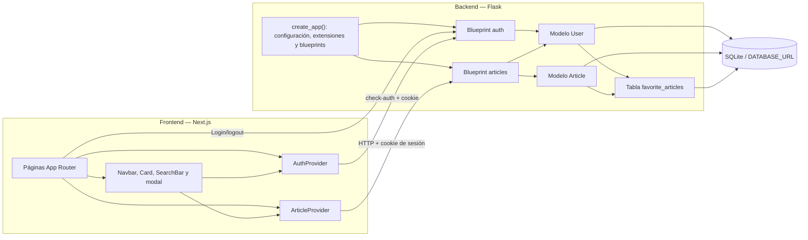
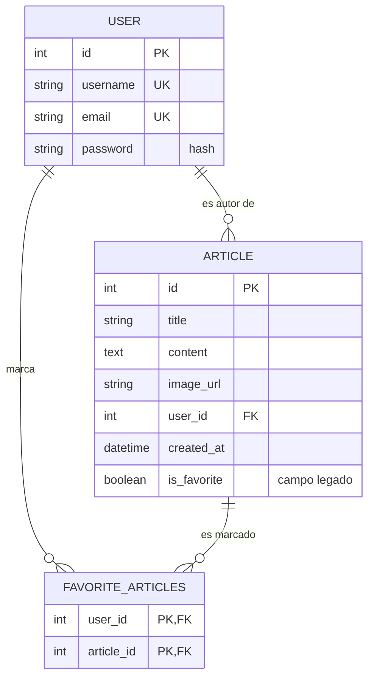
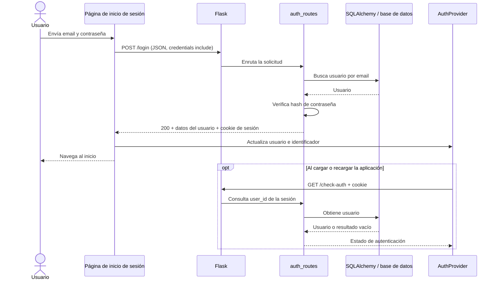

# DevMoon Blog


Aplicación web para publicar, explorar y guardar artículos y proyectos como favoritos. El proyecto integra una API REST desarrollada con Flask y SQLAlchemy, una base de datos SQLite y una interfaz construida con React y Next.js.

---

## Descripción General

DevMoon Blog permite consultar publicaciones, buscar por título o contenido y ver el detalle de cada artículo. Los visitantes pueden crear una cuenta e iniciar sesión para crear publicaciones y administrar su lista personal de favoritos. Al iniciar sesión, la navegación muestra el nombre del usuario; la interfaz también permite eliminar publicaciones y ofrece una vista dedicada para consultar los favoritos.

### Tecnologías Utilizadas

El backend utiliza Python, Flask y Flask-SQLAlchemy para definir la API y gestionar las operaciones de base de datos. SQLite almacena usuarios, artículos y la relación de favoritos. Werkzeug genera y verifica los hashes de contraseñas, y Flask-CORS permite las solicitudes del frontend con credenciales. La interfaz utiliza React, Next.js y TypeScript; sus estilos están implementados con Tailwind CSS, los iconos con Font Awesome y los diálogos de confirmación con SweetAlert2. Postman se utiliza para probar manualmente los endpoints.

### Arquitectura del Proyecto

`app.py` crea y configura la aplicación Flask mediante una factoría, inicializa SQLAlchemy y CORS y registra los blueprints de `routes/`. Las rutas reciben solicitudes HTTP y trabajan con los modelos de `Models/`; los módulos de `services/` agrupan funciones para autenticación y artículos. `User` administra las cuentas y sus relaciones, mientras que `Article` representa las publicaciones. El frontend Next.js usa App Router, componentes reutilizables y proveedores de contexto para compartir el estado de autenticación y artículos.

#### Patrones de Diseño y Organización

- **Application Factory:** `create_app()` centraliza la creación y configuración de Flask. Lee las variables de entorno, inicializa extensiones y registra las rutas.
- **Blueprints:** la API se divide por responsabilidad entre autenticación (`auth`) y artículos y favoritos (`articles`).
- **ORM y relaciones:** los modelos declarativos de SQLAlchemy representan las tablas y sus relaciones. Un usuario puede tener varios artículos; usuarios y artículos se relacionan para guardar favoritos mediante la tabla de asociación `favorite_articles`.
- **Módulos de servicio:** `services/` organiza funciones relacionadas con autenticación y operaciones de artículos.
- **Provider/Context de React:** `AuthProvider` comparte el estado de sesión e identidad; `ArticleProvider` mantiene artículos, favoritos, filtros y operaciones del catálogo.
- **Composición de componentes:** las páginas de Next.js ensamblan elementos reutilizables como la navegación, las tarjetas, la búsqueda y el formulario modal.
- **API HTTP con JSON y sesión por cookie:** el frontend intercambia JSON con Flask y envía credenciales para conservar la cookie de sesión. La autenticación se basa en sesiones de Flask, no en tokens JWT.

#### Diagrama de Componentes

Muestra el recorrido principal entre la interfaz, la API, los modelos y la base de datos. Los proveedores de React comparten estado en el frontend; los blueprints exponen los endpoints del backend.



#### Diagrama Entidad-Relación

Representa las entidades persistidas y las cardinalidades: cada artículo tiene un autor, y cada usuario puede marcar varios artículos como favoritos.



#### Diagrama de Secuencia: Inicio de Sesión

Describe la validación de credenciales, la creación de la sesión y la comprobación de autenticación al cargar nuevamente la aplicación.



### Modelos de la Base de Datos

El sistema cuenta con dos entidades principales. `User` almacena el nombre de usuario, correo electrónico único y contraseña hasheada. `Article` almacena título, contenido, URL de imagen, autor y fecha de creación. La tabla de asociación `favorite_articles` relaciona usuarios y artículos para guardar favoritos de forma independiente para cada usuario.

### Seguridad y Autenticación

Las contraseñas se guardan usando las funciones de hash de Werkzeug, no en texto plano. Flask mantiene la sesión del usuario mediante una cookie firmada con `FLASK_SECRET_KEY`; esta clave protege las sesiones y no es una clave de base de datos. En desarrollo, si no se configura, la aplicación genera una clave temporal nueva en cada inicio, por lo que las sesiones se invalidan al reiniciar. Para conservarlas, configura y reutiliza la misma clave fuera del repositorio. En producción, `APP_ENV=production` hace obligatorio configurar `FLASK_SECRET_KEY`; no uses `Moon159` ni subas claves al repositorio. `DATABASE_URL` configura la conexión a la base de datos y `CORS_ORIGINS` determina los orígenes permitidos. El endpoint `/check-auth` valida que el usuario de la sesión siga existiendo y devuelve su nombre e identificador cuando la sesión es válida. La creación de artículos y las operaciones de favoritos requieren una sesión iniciada. La eliminación de artículos valida que exista una sesión y que el usuario sea el autor.

### Flujo de Publicación y Favoritos

Un visitante puede consultar y buscar artículos, abrir su detalle y crear una cuenta desde `/register`. Después de registrarse e iniciar sesión, puede crear una publicación proporcionando título, contenido y URL de imagen. Los artículos se muestran en tarjetas con autor y fecha; desde ellas se puede abrir el detalle o marcar la publicación como favorita. La navegación muestra el nombre del usuario autenticado y permite alternar entre el catálogo y sus favoritos. La opción para eliminar solo aparece al autor de la publicación; al seleccionarla, SweetAlert2 solicita confirmación antes de enviar la eliminación.

### Pruebas de la API

El repositorio incluye solicitudes de Postman para probar el registro, el inicio de sesión y las operaciones de artículos y favoritos. Las pruebas se ejecutan manualmente con la API iniciada; no se incluye una suite de pruebas automatizadas.

---

## Requisitos

- Python y `pip`.
- Node.js y `npm`.
- Postman (opcional, para probar la API).

---

## Inicio Rápido

### API

Desde la carpeta raíz del proyecto, crea y activa un entorno virtual e instala las dependencias:

```powershell
python -m venv .venv
.venv\Scripts\Activate.ps1
pip install -r requirements.txt
```

La clave de sesión de Flask se configura con `FLASK_SECRET_KEY`. Para desarrollo puedes omitirla y usar la clave temporal, teniendo en cuenta que las sesiones no sobrevivirán a un reinicio. Si quieres conservarlas, genera una clave una vez y guárdala fuera del repositorio; no vuelvas a generar otra en cada inicio:

```powershell
$env:FLASK_SECRET_KEY = (python -c "import secrets; print(secrets.token_hex(32))")
```

El comando anterior la establece solo para la terminal actual. Para producción, configura `APP_ENV=production` y guarda `FLASK_SECRET_KEY` en las variables protegidas del servicio de despliegue. La aplicación no iniciará en producción si falta. No incluyas la clave real en el código ni en el repositorio. `DATABASE_URL` es opcional para SQLite local (`sqlite:///blog.db`); si la URI contiene credenciales, mantenla también fuera del repositorio. `CORS_ORIGINS` es una lista de orígenes separados por comas y por defecto permite `http://localhost:3000`.

Inicia la API desde la raíz del proyecto:

```powershell
python run.py
```

La API queda disponible en `http://127.0.0.1:5000`. Por defecto usa SQLite en `instance/blog.db`; la base de datos y sus tablas se crean al iniciar la aplicación.

### Frontend

En otra terminal, instala las dependencias e inicia Next.js:

```powershell
cd app-blog
npm install
npm install @fortawesome/free-regular-svg-icons
npm run dev
```

Abre `http://localhost:3000`. Mantén la API en ejecución para que el frontend pueda cargar y modificar los artículos.

---

## Estructura del Proyecto

```text
App_Flask/
├── app.py                         # Factoría Flask y configuración por entorno
├── run.py                         # Punto de entrada de desarrollo
├── requirements.txt               # Dependencias de Python
├── Models/
│   ├── __init__.py                # Instancia de SQLAlchemy
│   ├── article.py                 # Modelo de artículos y tabla de favoritos
│   └── user.py                    # Modelo de usuarios y contraseñas
├── routes/
│   ├── article_routes.py          # Endpoints de artículos y favoritos
│   └── auth_routes.py             # Endpoints de autenticación
├── services/
│   ├── article_services.py        # Interfaz de servicios para las rutas de artículos
│   ├── articles_services.py       # Operaciones de artículos y favoritos
│   └── auth_services.py           # Operaciones de autenticación
├── app-blog/
│   ├── app/
│   │   ├── article/[id]/          # Página de detalle de artículo
│   │   ├── components/             # Tarjetas, navegación, búsqueda y modal
│   │   ├── login/                  # Página de inicio de sesión
│   │   ├── register/               # Página de registro
│   │   ├── layout.tsx              # Layout raíz de Next.js
│   │   └── page.tsx                # Página de inicio
│   ├── context/                    # Estado compartido de autenticación y artículos
│   ├── types/                      # Tipos TypeScript
│   └── package.json                # Dependencias y scripts del frontend
└── postman/
    └── collections/                # Solicitudes de prueba para Auth y Articles
```

---

## Endpoints Disponibles

### Autenticación

| Método | Ruta | Descripción | Sesión requerida |
|--------|------|-------------|------------------|
| POST | `/register` | Crear una cuenta y guardar la contraseña hasheada | No |
| POST | `/login` | Iniciar sesión y devolver el nombre del usuario | No |
| GET | `/check-auth` | Validar la sesión y obtener el nombre del usuario autenticado | No |
| POST | `/logout` | Cerrar la sesión actual | No |

### Artículos

| Método | Ruta | Descripción | Sesión requerida |
|--------|------|-------------|------------------|
| GET | `/articles` | Listar artículos e indicar si son favoritos para la sesión | No |
| POST | `/create-article` | Crear un artículo asociado al usuario autenticado | Sí |
| GET | `/article/<id>` | Obtener un artículo por identificador | No |
| PUT | `/articles/<id>` | Actualizar el título y contenido de un artículo | No |
| DELETE | `/articles/<id>` | Eliminar un artículo propio; requiere sesión y valida la autoría | Sí |

### Favoritos

| Método | Ruta | Descripción | Sesión requerida |
|--------|------|-------------|------------------|
| GET | `/favorites` | Listar los artículos favoritos del usuario | Sí |
| POST | `/favorites/<id>` | Marcar o desmarcar un artículo como favorito | Sí |

Las solicitudes para registrar usuarios y crear artículos usan JSON. Ejemplo del cuerpo de una solicitud de creación:

```json
{
  "title": "Mi artículo",
  "content": "Contenido del artículo.",
  "image_url": "https://ejemplo.com/imagen.jpg"
}
```

Para actualizar un favorito, envía `{"isFavorite": true}` o `{"isFavorite": false}` a `POST /favorites/<id>`.

El registro recibe `username`, `email` y `password`, y devuelve un mensaje de confirmación al crear la cuenta. El inicio de sesión recibe `email` y `password`; cuando las credenciales son válidas, responde con `{"message": "Inicio de sesion exitoso", "username": "nombre", "userId": 1}` y crea la sesión.

`GET /check-auth` responde con `{"authenticated": true, "username": "nombre", "userId": 1}` cuando la sesión pertenece a un usuario válido. Si no hay una sesión válida, responde `{"authenticated": false, "username": ""}` con estado HTTP `200`. Las respuestas de `GET /articles` incluyen `userId` para identificar al autor de cada artículo.

---

## Dependencias Principales

| Dependencia | Propósito |
|-------------|-----------|
| Flask | Framework web para la API |
| Flask-SQLAlchemy | ORM y administración de la base de datos |
| Werkzeug | Hash y verificación de contraseñas |
| Flask-CORS | Solicitudes entre el frontend y la API |
| Next.js | Framework de la aplicación web |
| React | Construcción de la interfaz |
| TypeScript | Tipado estático del frontend |
| Tailwind CSS | Estilos de la interfaz |
| Font Awesome | Iconos de la interfaz |
| SweetAlert2 | Diálogo de confirmación y notificación al eliminar artículos |

---

## Seguridad

Las contraseñas se almacenan como hashes generados por Werkzeug y la autenticación utiliza sesiones de Flask en cookies, no tokens JWT. La clave de sesión y cualquier URI con credenciales deben configurarse en el entorno de ejecución y nunca guardarse en el repositorio. Usa una clave aleatoria fuerte y estable para producción; cambiarla invalida las sesiones existentes. La creación de artículos y el acceso y modificación de favoritos validan la sesión. La ruta de eliminación también requiere una sesión y comprueba que el usuario autenticado sea el autor; la ruta de actualización actualmente no requiere autenticación en la API.

---

## Pruebas

Para probar la API con Postman:

1. Inicia el backend siguiendo las instrucciones de Inicio Rápido.
2. Usa las solicitudes de `postman/collections/Auth-1` para registrar un usuario e iniciar sesión. La respuesta del login incluye el nombre de usuario.
3. Usa las solicitudes de `postman/collections/Articles` para listar, crear, consultar, actualizar o eliminar artículos propios y cambiar favoritos.
4. Mantén la sesión de Postman para las solicitudes que requieren autenticación.

La API también se puede probar con `curl` o cualquier cliente HTTP. No hay un comando de pruebas automatizadas configurado en el proyecto.
